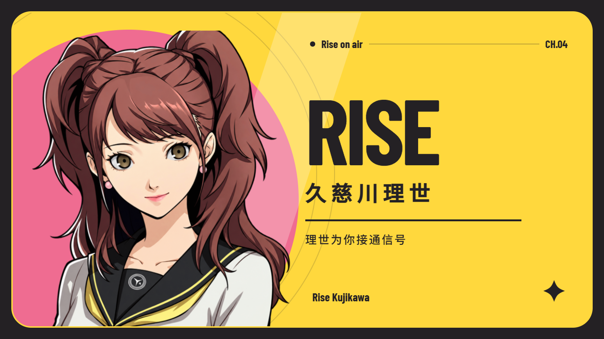

# Rise On Air · 理世为你接通信号

为 **Windows Codex 桌面客户端**制作的 Persona 4 / 久慈川理世同人主题套装：黄色电视框、珊瑚粉强调、理世壁纸，加上 3.2 秒有声启动动画和专用桌面图标。

基于 [Codex Dream Skin](https://github.com/Fei-Away/Codex-Dream-Skin) 为真实客户端加载主题，保留原生侧栏、项目选择、消息和输入框。不是用网页或截图替代 Codex，也不是 OpenAI、ATLUS 或 SEGA 官方产品。




## 一键安装

前往 **[Releases 下载 Windows 安装包](https://github.com/qt0713/RiseOnAir-Codex-P4R/releases/latest)**：

1. 下载 `RiseOnAir-Setup-v1.0.0-windows-x64.exe`；可用同页 `SHA256SUMS.txt` 核对摘要。
2. 保存 Codex 中尚未发送的输入，然后运行安装包。首次配置或需要更新引擎时可能关闭客户端；按当前用户安装，无需接管 WindowsApps。
3. 保持安装完成页的“启动 Codex 并应用理世主题”选项，或双击桌面 **Codex - 理世启动**。

安装包包含启动动画、人物素材、多尺寸 ICO、主题包、Dream Skin v1.5.21 官方安装器与恢复入口。缺少 WebView2 Runtime 时会调用微软官方引导程序，此时需要网络。**不包含 Codex 客户端本身**；请先从 Microsoft Store 安装并至少运行一次官方客户端。

公开安装包目前没有购买代码签名证书。请从本仓库 Release 获取并核对 SHA-256；不要关闭系统安全功能。企业策略不允许运行时，请使用组织批准的安装方式。

## 安装后有哪些入口

| 入口 | 行为 |
| --- | --- |
| 桌面 / 开始菜单：Codex - 理世启动 | 同时加载主题与播放 3.2 秒展示动画；客户端已有可见窗口时直接唤起。 |
| 开始菜单：预览启动动画 | 单独查看动画，不启动或关闭 Codex。 |
| 开始菜单：理世主题管理 | 打开上游主题管理界面，可管理已保存主题与背景。 |
| 开始菜单：恢复 Codex 原始外观 | 使用上游恢复流程恢复外观并关闭调试会话。 |

快捷方式直接引用安装目录中的 `rise-icon-v1.ico`，同时可执行文件内嵌同一图标。ICO 包含 **16 / 24 / 32 / 48 / 64 / 128 / 256 px**，保留透明圆角。安装结束会通知 Windows Shell 刷新，避免依赖工作区或临时目录中的图片。

## 动画与主题

- 展示动画为 3.2 秒：频道接通 → 理世登场 → 名字与 Codex → 淡出。
- 原版日语招呼在 0.68 秒起播，右上角可静音，`M` 切换声音，`Esc` 跳过。
- 角色、几何图形、文字分层；全部本地加载。宽屏、4:3、竖屏分别布局，窗口按显示器 DPI 与工作区适配。
- 原型源文件支持 `window.rise.seek(seconds)` 确定性跳转；时间跳转不依赖已经播放过的状态。
- 主题跟随客户端深浅色设置，聊天页采用 ambient 背景处理。按钮以明黄与浅珊瑚粉为强调色，去掉深紫色填充；主要操作使用深色文字。
- 动画结束但主题尚未验证时显示静态等待画面，不把固定 3.2 秒伪装成加载进度。
- 验证失败由上游启动事务恢复本次外观修改，保留已有主题会话；日志会记录失败，不会把“文件已复制”显示为“主题已生效”。

## 兼容性与技术边界

当前目标为 Windows 10/11 x64、Microsoft Store 注册的 `OpenAI.Codex` 客户端、.NET Framework 4.8 与 WebView2 Runtime。

本机已验证 Codex **26.1013.4894.0** 可加载 `p4r-rise-on-air`，原生输入框与侧栏存在，客户端验证返回通过；125% DPI 下播放与窗口适配正常。独立主题预览覆盖深浅色、首页/聊天页和 390 / 1024 / 1440 px；动画布局另覆盖 1280×720、1920×1080、4:3 和竖屏。不能据此保证所有 Windows、显示器组合或未来 Codex 版本都兼容。统一安装包的检查记录见 [测试说明](docs/TESTING.md)。

Dream Skin 使用绑定到 `127.0.0.1` 的本机 CDP 调试会话，**CDP 没有同用户身份验证**。完整恢复或关闭全部调试客户端后，从官方普通入口启动，才能结束该会话；仅暂停主题不会关闭端口。更多边界见 [上游 SECURITY.md](https://github.com/Fei-Away/Codex-Dream-Skin/blob/main/SECURITY.md)。

不修改官方 `app.asar`、WindowsApps、签名、账户、聊天记录、宠物、插件、API Key 或模型供应商配置。官方客户端更新可能改变调试接口或控件结构；请查看 [上游兼容性说明](https://github.com/Fei-Away/Codex-Dream-Skin/blob/main/windows/README.md)。

## 恢复与卸载

先使用开始菜单“恢复 Codex 原始外观”。卸载可在 Windows“设置 → 应用”中选择 **Rise On Air · 理世主题**。卸载先恢复官方外观；恢复失败会保留文件并停止卸载，避免失去恢复入口。

不卸载 Codex。本项目也不会擅自删除上游 Dream Skin 的共享主题库、个人主题和配置备份；若不再需要上游工具，可单独使用它自己的卸载入口。

## 从源码构建

需要 Windows、.NET Framework 编译器、Inno Setup 6.5.3+。第三方安装器与 WebView2 SDK 不放入 Git 历史；构建时下载固定版本并校验。

```powershell
.\tools\fetch-dependencies.ps1
.\tools\build.ps1 -Compiler "C:\Program Files (x86)\Inno Setup 6\ISCC.exe"
```

输出位于 `dist/`。`build/`、`dependencies/`、日志、WebView 用户数据、配置备份和聊天截图均不进入仓库。字体及本地素材已随源码提供，用户安装时不需要安装 skill、Node.js、Python 或克隆本仓库。

## 致谢与引用

- **主题引擎**：[Fei-Away/Codex-Dream-Skin](https://github.com/Fei-Away/Codex-Dream-Skin)，使用 [v1.5.21](https://github.com/Fei-Away/Codex-Dream-Skin/releases/tag/v1.5.21)，保留 MIT 许可。原创集成层、动画和安装流程由本项目提供。
- **角色视觉**：以用户提供的带 DAT 签名的插画为造型参考，透明人物、壁纸和图标经 imagegen 生成；原参考链接未核实，未将参考原图放入仓库。**不是经确认的官方 P4R 立绘**。
- **原音**：[ATLUS 官方发布页](https://p-ch.jp/news/634/) 与 [P4D × DENON 官方视频](https://www.youtube.com/watch?v=RcDYtORu-Nw)，久慈川理世 CV：钉宫理惠。截取原片 1.28–3.58 秒。「やっほー！りせちーだよ～」是 P4D 宣传录音，不冒称 P4R/P4G 游戏内采样。
- **字体**：[Barlow Condensed](https://github.com/google/fonts/tree/main/ofl/barlowcondensed) 与 [Noto Sans SC](https://github.com/notofonts/noto-cjk)，SIL OFL；发布版不打包微软雅黑、Arial Narrow。

完整来源、许可证和素材边界见 **[THIRD_PARTY_NOTICES.md](THIRD_PARTY_NOTICES.md)**。本项目原创代码使用 [MIT](LICENSE)；该许可不授权第三方角色、录音或商标的商业使用。
