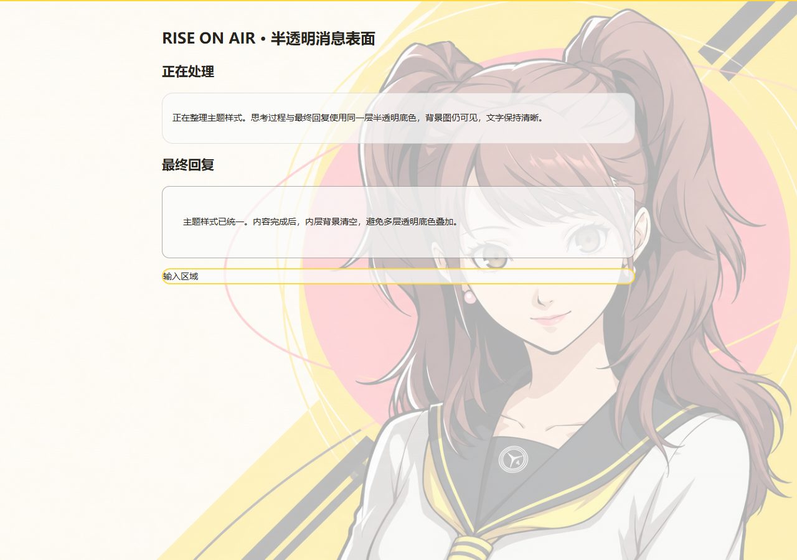

# Rise On Air · 理世为你接通信号

为 **Windows / macOS Codex 桌面客户端**制作的 Persona 4 / 久慈川理世同人主题套装：黄色电视框、珊瑚粉强调、理世壁纸，加上 3.2 秒有声启动动画和专用桌面图标。

基于 [Codex Dream Skin](https://github.com/Fei-Away/Codex-Dream-Skin) 为真实客户端加载主题，保留原生侧栏、项目选择、消息和输入框。不是用网页或截图替代 Codex，也不是 OpenAI、ATLUS 或 SEGA 官方产品。


## macOS 版（Beta）

原生 AppKit / WKWebView 启动器、Universal 二进制、理世 ICNS 图标和 DMG/ZIP。[下载 macOS Beta](https://github.com/qt0713/RiseOnAir-Codex-P4R/releases/tag/v1.1.0-beta.2)，安装与测试范围见 **[macOS 中文说明](docs/MACOS.md)**。macOS 版与 Windows 安装包分开发布；Beta 不代表真实登录用户的主题接入已经全场景验收。

## Windows 一键安装

前往 **[Releases 下载 Windows 安装包](https://github.com/qt0713/RiseOnAir-Codex-P4R/releases/latest)**：

1. 下载 `RiseOnAir-Setup-v1.0.5-windows-x64.exe`；可用同页 `SHA256SUMS.txt` 核对摘要。
2. 保存 Codex 中尚未发送的输入，然后运行安装包。首次配置或需要更新引擎时可能关闭客户端；按当前用户安装，无需接管 WindowsApps。
3. 保持安装完成页的“启动 Codex 并应用理世主题”选项，或双击桌面 **Codex - 理世启动**。
4. 打开 Windows **设置 → 应用 → 启动**，关闭 OpenAI 的 **Codex / ChatGPT** 普通登录启动，保留 **RiseOnAir.exe** 开启。这一步避免官方普通模式抢先启动；Windows 上该包目前显示名可能为 ChatGPT。不要同时开启两个入口。

安装包包含启动动画、人物素材、多尺寸 ICO、主题包、Dream Skin v1.5.21 官方安装器与恢复入口。缺少 WebView2 Runtime 时会调用微软官方引导程序，此时需要网络。**不包含 Codex 客户端本身**；请先从 Microsoft Store 安装并至少运行一次官方客户端。

公开安装包目前没有购买代码签名证书。请从本仓库 Release 获取并核对 SHA-256；不要关闭系统安全功能。企业策略不允许运行时，请使用组织批准的安装方式。

## 安装后有哪些入口

| 入口 | 行为 |
| --- | --- |
| 桌面 / 开始菜单 / 理世任务栏图标 | 每次手动打开均播放 3.2 秒展示动画；已有客户端时，主题校验在后台进行，动画后唤起已有窗口。 |
| 开始菜单：预览启动动画 | 单独查看动画，不启动或关闭 Codex。 |
| 开始菜单：理世主题管理 | 打开上游主题管理界面，可管理已保存主题与背景。 |
| 开始菜单：恢复 Codex 原始外观 | 使用上游恢复流程恢复外观并关闭调试会话。 |

快捷方式直接引用安装目录中的 `rise-icon-v1.ico`，同时可执行文件内嵌同一图标。ICO 包含 **16 / 24 / 32 / 48 / 64 / 128 / 256 px**，保留透明圆角。安装结束会通知 Windows Shell 刷新，避免依赖工作区或临时目录中的图片。

## v1.0.5：修复后台驻留时的桌面启动

修复 Codex 仍在后台、主窗口不可见时，启动器误判冷启动并卡在等待页的问题。现在先通过上游的包身份、回环端口归属和已保存 Browser ID 校验，读取主页面的窗口几何信息，再匹配并恢复同一浏览器进程的原生主窗口。人物悬浮层、独立窗口及普通模式的后台实例不再作为主题主窗口交接目标；不会用普通应用入口另开实例，也不会强制退出原有会话。

主窗口恢复与展示动画并行；实际可见后才交接，主题验证仍独立进行。理世运行图标也绑定到这个已确认的窗口。后台请求不弹出重启确认，等待画面中的 Esc 可以正常退出。若身份或主窗口匹配失败，显示可重试的等待状态，保留原会话。

升级会重新创建桌面 **Codex - 理世启动**，继续引用安装目录的本地图标。已实测真实主窗口隐藏后通过新桌面快捷方式恢复、最小化后恢复，以及桌面和任务栏快捷方式的展示动画。验证范围与未验证项见 [验证记录](docs/TESTING.md)。本次为 Windows 修复，macOS Beta 版本保持原有发布。
## v1.0.4：恢复桌面与任务栏的手动动画

**v1.0.4 补充修复**：手动入口在已有窗口时也播放展示版，启动动画不再被后台校验锁住。登录恢复使用独立启动锁；已有主题校验在运行时，新后台请求直接合并，不排队。理世启动器固定项与官方运行窗口使用不同 AppUserModelID，避免任务栏直接切换已有窗口而绕过启动器。运行中的官方窗口可能显示单独的任务栏按钮；需要动画时点击理世启动器固定项。

启动器与运行窗口都使用理世图标。运行窗口采用独立的 `.Client` 分组，并由本项目的无窗口 `RiseIconBridge.exe` 保持大小图标，避免重新显示 GPT 标识；官方程序和图标资源文件不改动。辅助进程在客户端退出时结束，恢复外观时还原原图标，升级时先安全退出再重新启动。

已有客户端的动画结束后会切回现有窗口，这只表示窗口可用，不把后台主题校验标记为已成功；冷启动仍等待真实主题验证。当前安装的手动入口始终使用 3.2 秒展示版。

## v1.0.3：任务栏入口与登录恢复

修复已有窗口直接跳过主题验证、隐藏 PowerShell 经 Shell 启动可能出现终端、取消重启仍误报就绪的问题。就绪标记绑定每次启动的随机令牌，并在真实主题验证后写入。

安装会为本项目写入 **HKCU Run / RiseOnAir** 登录项，命令为安装目录 `RiseOnAir.exe --login`。下一次登录时打开 Codex 并恢复主题，不播放动画、不请求重启、不强关已有会话。若普通 Codex 抢先启动而没有 CDP，后台只记录失败；保存工作后退出 Codex，再打开理世入口。恢复外观或卸载时移除此登录项。

官方包自身声明了启用的登录启动任务。请按上面的第 4 步在系统设置中关闭重复项；安装器不修改其他应用的内部启动状态注册表。需要恢复官方登录启动时，可在同一页面重新开启。

任务栏使用独立标识 `qt0713.RiseOnAir.Codex`，匹配的传统固定快捷方式会备份后改为理世启动器；已验证的官方窗口也设置对应的重新打开命令和图标。**Windows 的商店固定项可能仍缓存官方入口**，系统合并规则不允许可靠地用快捷方式替换它。升级后若点击旧图标仍走普通入口，请取消固定旧 Codex 图标，再将开始菜单 **Codex - 理世启动** 固定到任务栏一次。不会编辑任务栏二进制注册表或修改官方程序来强制替换固定项。

登录恢复成功后，官方图标会唤起已有主题会话；关闭所有客户端后再冷启动普通官方图标，仍不能保证带有主题所需参数。登录恢复本身保持静默；手动点击理世入口会播放动画。

## 动画与主题

- 展示动画为 3.2 秒：频道接通 → 理世登场 → 名字与 Codex → 淡出。
- 原版日语招呼在 0.68 秒起播，右上角可静音，`M` 切换声音，`Esc` 跳过。
- 角色、几何图形、文字分层；全部本地加载。宽屏、4:3、竖屏分别布局，窗口按显示器 DPI 与工作区适配。
- 原型源文件支持 `window.rise.seek(seconds)` 确定性跳转；时间跳转不依赖已经播放过的状态。
- 主题跟随客户端深浅色设置，聊天页采用 ambient 背景处理。按钮以明黄与浅珊瑚粉为强调色，去掉深紫色填充；主要操作使用深色文字。
- 动画结束但主题尚未验证时显示静态等待画面，不把固定 3.2 秒伪装成加载进度。
- 验证失败由上游启动事务恢复本次外观修改，保留已有主题会话；日志会记录失败，不会把“文件已复制”显示为“主题已生效”。

## v1.0.2：补齐工具摘要与运行中发送按钮

工具操作摘要条及其展开内容，与思考过程共用半透明面板。运行中追加指令、排队/引导发送按钮统一为明黄底、深墨色箭头；焦点、禁用和提交行为保持原生逻辑。

## v1.0.1：思考过程与最终回复统一半透明

思考过程与最终回复共用主题的半透明面板色（默认 70% 不透明度，保留 30% 背景），移除思考过程额外的渐变、阴影和强模糊。文字本身保持完全不透明；内容完成后，内部面板清空背景，避免多层叠加。



上游 v1.5.21 的 Safe CSS 消息选择器不涵盖流式思考节点，因此完整安装器另含 `src/runtime/rise-surfaces.css` 与精确版本适配脚本。脚本只修改用户目录内的 Dream Skin 注入器，先核对上游 SHA-256、保留原文件；额外样式仅对 `p4r-rise-on-air` 加载。卸载时恢复原注入器；遇到未知修改拒绝覆盖。**只导入三文件 theme.zip 不包含此修复**，请使用完整安装包升级。官方 Codex 文件不变。

## 兼容性与技术边界

当前目标为 Windows 10/11 x64、Microsoft Store 注册的 `OpenAI.Codex` 客户端、.NET Framework 4.8 与 WebView2 Runtime。

本机已验证 Codex **26.1013.4894.0** 可加载 `p4r-rise-on-air`，原生输入框与侧栏存在，客户端验证返回通过；125% DPI 下播放与窗口适配正常。独立主题预览覆盖深浅色、首页/聊天页和 390 / 1024 / 1440 px；动画布局另覆盖 1280×720、1920×1080、4:3 和竖屏。不能据此保证所有 Windows、显示器组合或未来 Codex 版本都兼容。统一安装包的检查记录见 [测试说明](docs/TESTING.md)。

Dream Skin 使用绑定到 `127.0.0.1` 的本机 CDP 调试会话，**CDP 没有同用户身份验证**。完整恢复或关闭全部调试客户端后，从官方普通入口启动，才能结束该会话；仅暂停主题不会关闭端口。更多边界见 [上游 SECURITY.md](https://github.com/Fei-Away/Codex-Dream-Skin/blob/main/SECURITY.md)。

不修改官方 `app.asar`、WindowsApps、签名、账户、聊天记录、宠物、插件、API Key 或模型供应商配置。官方客户端更新可能改变调试接口或控件结构；请查看 [上游兼容性说明](https://github.com/Fei-Away/Codex-Dream-Skin/blob/main/windows/README.md)。

## 恢复与卸载

先使用开始菜单“恢复 Codex 原始外观”。卸载可在 Windows“设置 → 应用”中选择 **Rise On Air · 理世主题**。卸载先恢复官方外观；恢复失败会保留文件并停止卸载，避免失去恢复入口。

不卸载 Codex。本项目也不会擅自删除上游 Dream Skin 的共享主题库、个人主题和配置备份；若不再需要上游工具，可单独使用它自己的卸载入口。

## 从源码构建

需要 Windows、.NET Framework 编译器、Inno Setup 6.5.3+。第三方安装器与 WebView2 SDK 不放入 Git 历史；构建时下载固定版本并校验。

```powershell
.\tools\fetch-dependencies.ps1
.\tools\build.ps1 -Compiler "C:\Program Files (x86)\Inno Setup 6\ISCC.exe"
```

输出位于 `dist/`。`build/`、`dependencies/`、日志、WebView 用户数据、配置备份和聊天截图均不进入仓库。字体及本地素材已随源码提供，用户安装时不需要安装 skill、Node.js、Python 或克隆本仓库。

## 致谢与引用

- **主题引擎**：[Fei-Away/Codex-Dream-Skin](https://github.com/Fei-Away/Codex-Dream-Skin)，使用 [v1.5.21](https://github.com/Fei-Away/Codex-Dream-Skin/releases/tag/v1.5.21)，保留 MIT 许可。原创集成层、动画和安装流程由本项目提供。
- **角色视觉**：以用户提供的带 DAT 签名的插画为造型参考，透明人物、壁纸和图标经 imagegen 生成；原参考链接未核实，未将参考原图放入仓库。**不是经确认的官方 P4R 立绘**。
- **原音**：[ATLUS 官方发布页](https://p-ch.jp/news/634/) 与 [P4D × DENON 官方视频](https://www.youtube.com/watch?v=RcDYtORu-Nw)，久慈川理世 CV：钉宫理惠。截取原片 1.28–3.58 秒。「やっほー！りせちーだよ～」是 P4D 宣传录音，不冒称 P4R/P4G 游戏内采样。
- **字体**：[Barlow Condensed](https://github.com/google/fonts/tree/main/ofl/barlowcondensed) 与 [Noto Sans SC](https://github.com/notofonts/noto-cjk)，SIL OFL；发布版不打包微软雅黑、Arial Narrow。

完整来源、许可证和素材边界见 **[THIRD_PARTY_NOTICES.md](THIRD_PARTY_NOTICES.md)**。本项目原创代码使用 [MIT](LICENSE)；该许可不授权第三方角色、录音或商标的商业使用。
