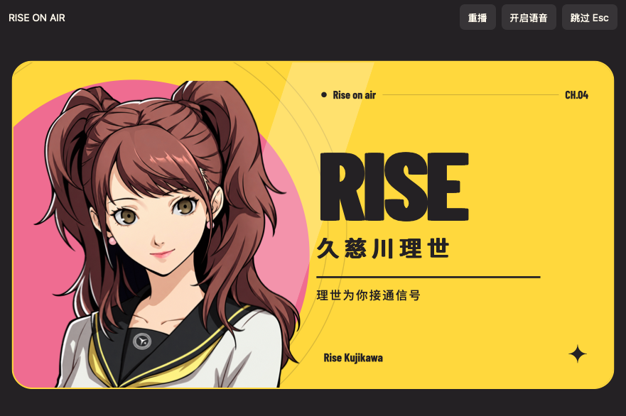

# macOS 下载与使用

macOS 当前版为 **1.1.0-beta.5**，提供 Universal 原生应用（Apple Silicon / Intel），最低 macOS 14。

## 安装

1. 先安装并运行官方 Codex / 新版 ChatGPT 桌面客户端一次，再退出。主题引擎要求官方包 ID `com.openai.codex`，并校验其应用签名、OpenAI Team ID 和自带 Node 运行时；缺少合格运行时会停止，不会要求安装 Homebrew 或来历不明的 Node。
2. 下载 `RiseOnAir-v1.1.0-beta.5-macos-universal.dmg`，打开后把 **Rise On Air.app** 拖入 Applications。也提供 ZIP 作为替代。
3. 打开 Rise On Air，按原生提示安装并启动。首次配置或引擎升级前请保存输入并退出官方客户端；后续先检查当前主题首帧，通过则直接复用；失败才恢复，由上游启动事务确认首帧就绪。完整布局检查在后台运行。冷热启动均播放展示动画。

## 登录恢复与 Dock 入口

从访达或 Dock 直接打开 **Rise On Air.app**。beta.5 默认只在点击时启动；升级时会清理旧版自建的登录项，遗留登录调用直接退出。固定官方客户端图标只会走官方入口。

正式播放使用 WebKit 动画时间轴，不再逐帧重设图层或中途生成整窗 PNG。动画结束即让出屏幕，主题仍在后台验证。冷启动跳过不适用的旧会话检查；启动或重启官方应用前仍执行完整签名校验。已有实例的只读首帧检查保留签名、团队、运行时和端口归属检查。遇到旧进程号被复用时，仅在创建时间证明进程已改变时备份旧状态并继续，不结束当前占用者。

本项目没有 Apple Developer ID 和公证资格，构建使用 ad-hoc 完整性签名。Gatekeeper 可能阻止首次打开：请由你自行按照系统的“隐私与安全性”提示处理。不要关闭 Gatekeeper，不需要执行删除隔离属性的命令。

## 功能

- 原生 AppKit 窗口与 WKWebView 本地播放，3.2 秒展示动画及理世日语招呼；静音按钮、M、Esc 跳过，菜单支持重播预览。
- 原生窗口可缩放，Retina 分辨率支持；动画根据内容区域选择宽屏、紧凑和竖屏布局。
- 理世 ICNS 图标；可以将应用保留在 Dock。不会替换官方客户端图标或修改官方应用包。
- 同时启动主题接入与动画。动画结束即收起，主题就绪以真实验证结果为准。不会把动画时长当作加载进度。
- 保留 Windows 版已经补齐的思考/工具摘要半透明、明黄主按钮与深色箭头兼容样式。

## 数据、恢复与卸载

本项目引擎、主题状态和日志均位于：

`~/Library/Application Support/RiseOnAir/`

它与普通 Dream Skin 的共享安装目录隔离；不覆盖其他主题引擎。引擎源自上游 v1.5.21，构建时核对精确源码摘要，再修改本项目自己的状态目录、launchd 标识和理世 CSS 加载入口。官方 `.app`、签名与账户文件保持原样。主题仍通过本机回环 CDP 运行，CDP 无同用户身份验证，使用边界见上游安全说明。

恢复时在应用菜单选择 **恢复官方外观**，确认保存输入后执行恢复并重启官方客户端。恢复成功后可以把 Rise On Air.app 移到废纸篓。默认保留用户目录内的恢复副本与日志；不要在恢复前删除这些文件。

## 测试范围

GitHub Actions 在 `macos-15`（Apple Silicon）和 `macos-15-intel` 上编译 Universal 二进制并运行原生 WKWebView 自测，检查本地动画播放、字体/图片、音频元数据、截图、资源摘要、缺少官方应用时拒绝安装、配置保留、符号链接拒绝和 DMG 挂载。每次测试报告与原生预览图作为 Actions Artifact 保存。

**这些测试不等于登录用户真实 Codex 主题接入通过。** CI 不包含你的账号、聊天或登录状态；尚需在真实 Mac 的当前官方客户端上完成主题加载、恢复和日常冷启动验收。因此本版标记为 Beta，无法确认支持的客户端会停止并提供日志，不将模拟界面当成主题加载成功。

角色、录音、字体、上游引擎的来源和许可见根目录 `THIRD_PARTY_NOTICES.md`。这不是 OpenAI、ATLUS 或 SEGA 官方产品。

## beta.1 的历史测试结果

[macOS 原生构建与测试 run 39155338626](https://github.com/qt0713/RiseOnAir-Codex-P4R/actions/runs/39155338626) 已通过。Apple Silicon 与 Intel 均在 macOS 15.7.9 上运行：原生 WKWebView 播放 3.2 秒并结束、音频元数据与播放启动正常、截图成功，资源与配置保护检查通过；Universal 双架构检查、ad-hoc 签名校验和 DMG 只读挂载验证通过。

构建来源为提交 `b1c2264be04f5c8bfdd311e3eb340c31df2bd518`；后续提交只补充测试记录与文档。下载包来自通过测试的 Apple Silicon runner，同一 Universal 二进制同时包含 arm64 与 x86_64。Intel runner 另行构建并运行了原生测试。

## beta.3 同步修复

主题验证通过前不会报告启动成功；动画播放与主题恢复并行，验证和播放均完成后才交接。AppKit 负责已有应用激活，不使用 Windows 专用 IPC。修复预览重播等待层残留，重复点击重试不会开启并行操作。Mac 原本只在安装阶段复制主题素材，本轮未引入 Windows 的每次素材导入流程。

CI 新增已有主题直接复用、缺失主题恢复、恢复失败不报告成功三类夹具测试。运行中的真实登录窗口、冷启动耗时及系统重启恢复仍待真实 Mac 验收，不沿用 Windows 的测速结论。

## beta.3 原生 CI 验收记录

2026-10-20，[GitHub Actions run 39396182084](https://github.com/qt0713/RiseOnAir-Codex-P4R/actions/runs/39396182084) 的 macos-15、macos-15-intel 和 release 三项全部成功。双平台均完成 Universal 编译、原生 WKWebView/音频/截图、资源安全及启动分支回归测试、签名校验和 DMG 挂载。

发布源码提交为 e85642f，DMG、ZIP 和 SHA256SUMS-macos.txt 已公开上传至 [beta.3 Release](https://github.com/qt0713/RiseOnAir-Codex-P4R/releases/tag/v1.1.0-beta.3)。这不替代真实登录用户的客户端冷启动与后台恢复验收。

## beta.4 启动优化与原生 CI 验收记录

2026-10-21，[GitHub Actions run 39503380042](https://github.com/qt0713/RiseOnAir-Codex-P4R/actions/runs/39503380042) 的 Apple Silicon、Intel 和发布任务全部通过。源码提交为 `4f8619a16baaa47ef9d3d9ebb427ce06df8b002f`；[beta.4 Release](https://github.com/qt0713/RiseOnAir-Codex-P4R/releases/tag/v1.1.0-beta.4) 已提供 Universal DMG、ZIP 和校验文件。

本次新增首帧检查、1.5 秒已有会话探测、启动事务确认后直接交接，以及独立后台完整审计。两个 runner 均通过原生动画/音频/截图、Blob 伪元素壁纸检测、慢速或失败审计不阻塞启动、取消不误报成功、资源安全、签名与 DMG 挂载检查。发布文件的 GitHub SHA-256 摘要已与下载的 SHA256SUMS-macos.txt 一致核对。

CI 没有真实登录的 Codex 会话，因此不承诺 Mac 的实际冷启动秒数。Windows 本机及用户已确认的提速不能代替 Mac 实机验收。升级前仍需保存输入、退出官方客户端，用新应用完成引擎更新。
